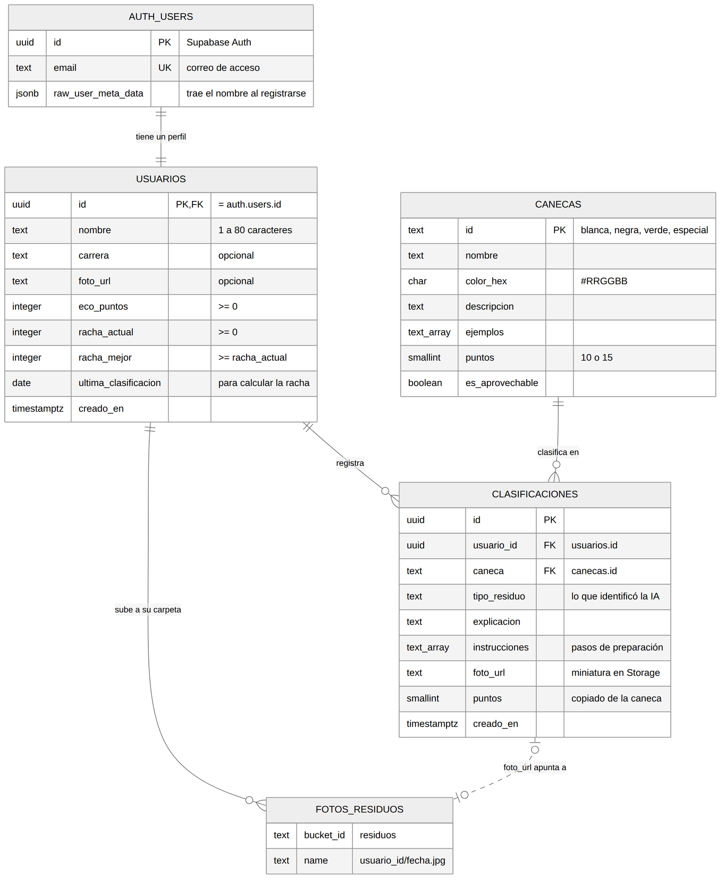
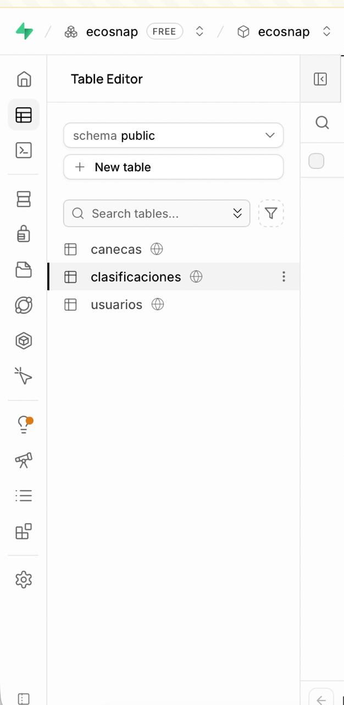
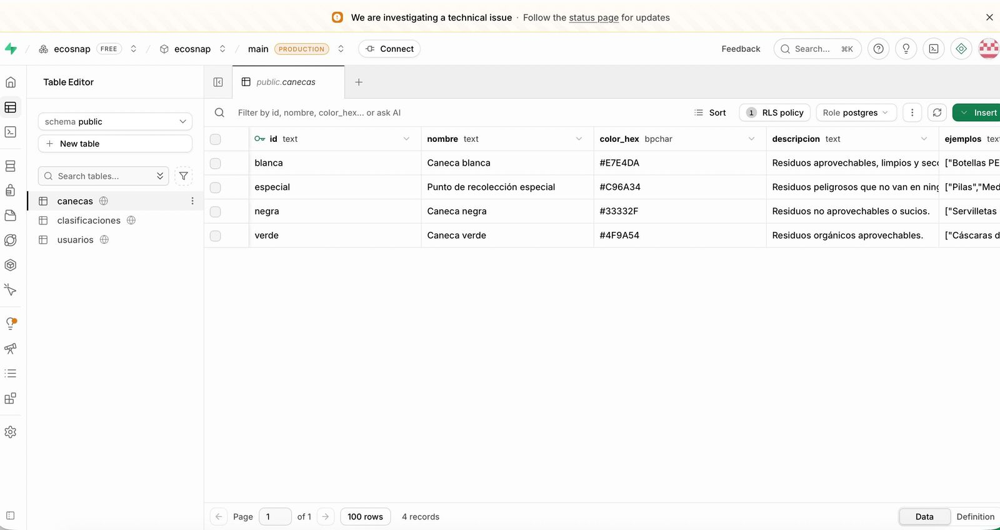
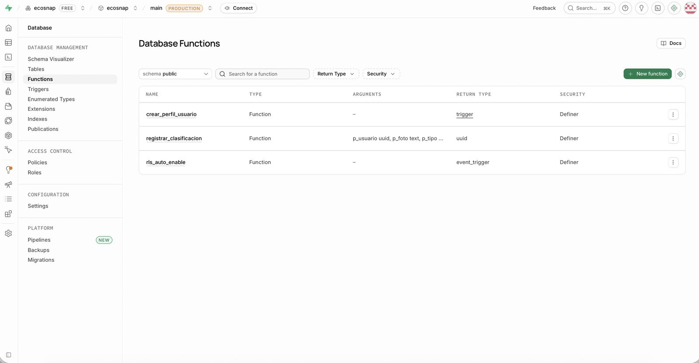
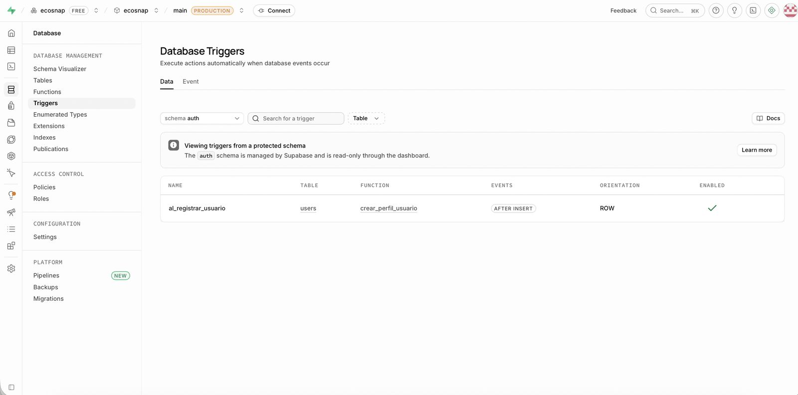
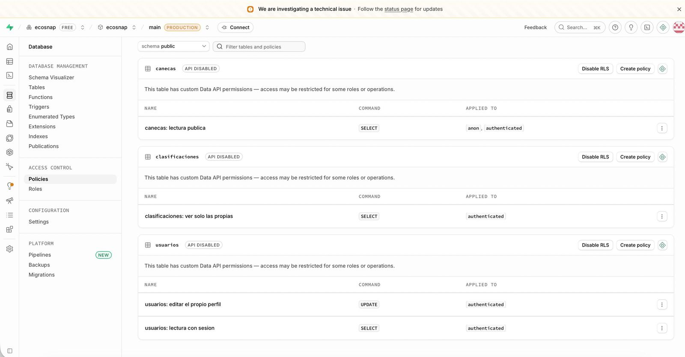
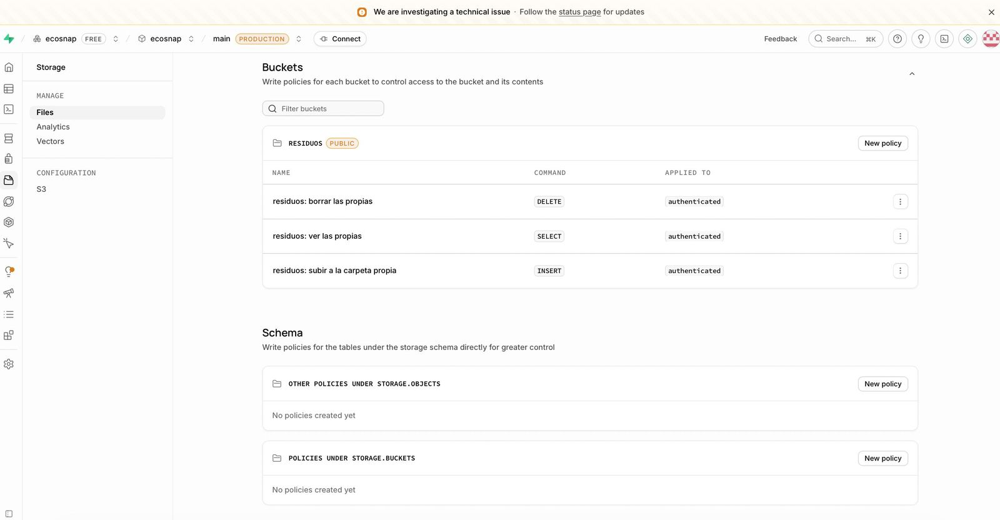
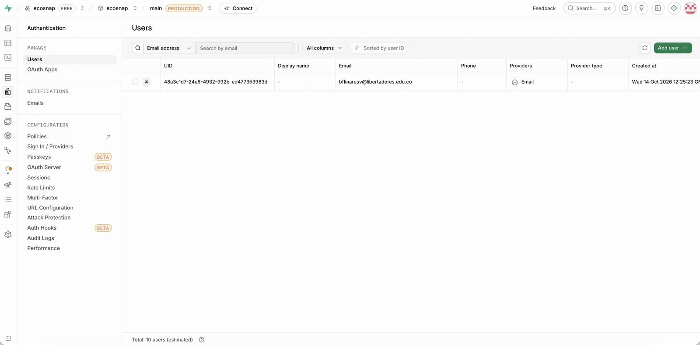
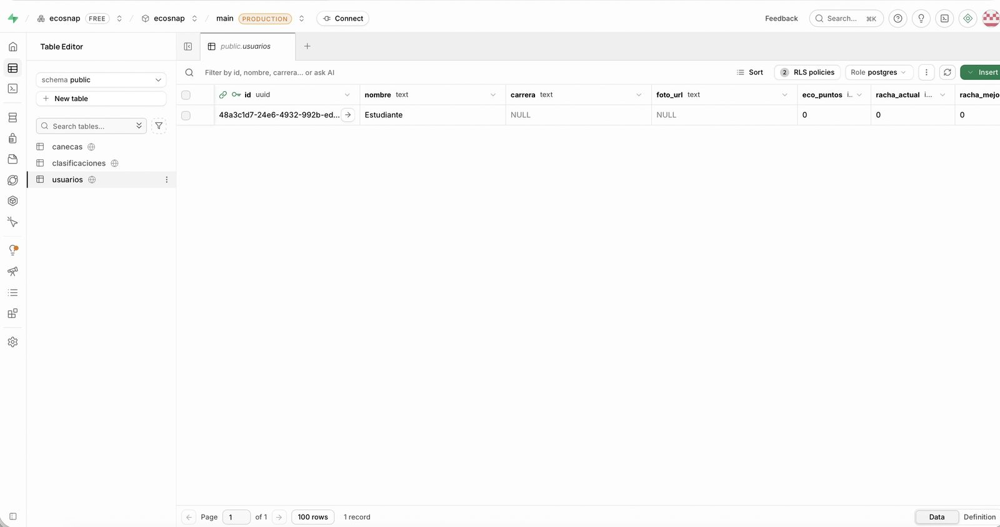

# Reporte de Sprint Review - Cierre de Corte II

**Asignatura:** Mobile and Cloud Computing - IS0276 - 210
**Proyecto:** EcoSnap · clasificación de residuos con IA
**Equipo de Desarrollo:**
- Brandon Felipe Linares Viasus - [@blinaresv](https://github.com/blinaresv) - Autenticación y perfil (HU-01 a HU-06), tablas y modelado de la base de datos, APK
- Sariath Eyleen Xiomara Ariza Vargas - [@Sariaht](https://github.com/Sariaht) - Clasificación con IA (HU-07 a HU-12), trigger, función de registro y diagrama ER
- Adriana Lucia Carreño Medina - [@Adrilu22](https://github.com/Adrilu22) - Gamificación y navegación (HU-13 a HU-18), seguridad por fila y diccionario de datos

**Fecha de la Sprint Review:** 21/10/2026
**Enlace a la Discusión en GitHub Discussions:** https://github.com/ecosnap-app/ecosnap-frontend/discussions/69
**Enlace a la Demo en Video:** https://youtu.be/a9w89JDSXn8
**Enlace al APK / Release:** https://github.com/ecosnap-app/ecosnap-frontend/releases/tag/v1.1.0-corte2
**Tablero Kanban:** https://github.com/orgs/ecosnap-app/projects

---

## 1. Resumen Ejecutivo del Incremento de Software

Al cierre del Corte II, EcoSnap pasó de ser un esqueleto que corría en modo demo a una aplicación conectada a una base de datos real en la nube. El incremento tiene tres partes.

La primera es la corrección de los 12 bugs y code smells que reportó el docente en los issues #30 a #53 (Taller 5), más el #27, que tenía `main` sin compilar. Cada corrección se hizo en su propia rama y entró a `main` por Pull Request, en un orden por turnos para que no hubiera conflictos entre issues que tocaban el mismo archivo. El CI (TypeScript, 17 pruebas de Jest y compilación del bundle de Android) está en verde en `main`.

La segunda es la base de datos (Taller 6): un proyecto de Supabase (PostgreSQL, región São Paulo) con las tablas `usuarios`, `canecas` y `clasificaciones`, un trigger que crea el perfil al registrarse, una función transaccional para guardar clasificaciones con sus puntos y su racha, seguridad por fila (RLS) y un bucket de Storage para las fotos.

La tercera es la integración entre las dos. Con las credenciales en el `.env`, la app deja el modo demo: el registro crea la cuenta en Supabase Auth y el trigger inserta el perfil en `usuarios`; el inicio, el perfil y el ranking leen esos datos reales; y la sesión se guarda cifrada en el Keychain o Keystore del celular. En el video se registra una cuenta nueva desde la app y se ve aparecer, al mismo tiempo, en la consola de Supabase.

Lo que queda pendiente es la clasificación con IA de punta a punta: el BFF que consulta a Gemini todavía no está desplegado, y por eso las historias que dependen de guardar una clasificación (puntos, racha, historial con datos) pasan al Corte III. La base de datos ya está lista para recibirlas.

**Stack:** React Native + Expo SDK 57 + TypeScript · Expo Router · MVVM · Supabase (Auth, PostgreSQL, Storage) · Jest · GitHub Actions · EAS Build.

---

## 2. Matriz de Trazabilidad: Historias de Usuario y Bugs del Sprint (Taller 5)

### Bugs e issues reportados por @endijromero

| Tipo (HU/Bug) | ID Issue | Título de la Incidencia | Responsable | Rama Git | Pull Request (PR) | Estado (Done / Incomplete) |
| :--- | :--- | :--- | :--- | :--- | :--- | :--- |
| BUG | [#27](https://github.com/ecosnap-app/ecosnap-frontend/issues/27) | Fallo de CI en el flujo de clasificación (`main` no compilaba) | @blinaresv | `fix/27-ci-clasificacion` | [PR #54](https://github.com/ecosnap-app/ecosnap-frontend/pull/54) (Merged) | Done |
| BUG | [#44](https://github.com/ecosnap-app/ecosnap-frontend/issues/44) | Ausencia del autocompletado de contraseñas nativo | @Sariaht | `fix/44-autocompletar-contrasena` | [PR #55](https://github.com/ecosnap-app/ecosnap-frontend/pull/55) (Merged) | Done |
| BUG | [#50](https://github.com/ecosnap-app/ecosnap-frontend/issues/50) | Variable de timeout de API global e inflexible | @Adrilu22 | `fix/50-timeout-configurable` | [PR #56](https://github.com/ecosnap-app/ecosnap-frontend/pull/56) (Merged) | Done |
| BUG | [#36](https://github.com/ecosnap-app/ecosnap-frontend/issues/36) | Validación de formato de correo inexistente | @blinaresv | `fix/36-validar-correo` y `fix/36-validar-correo-supabase` | [PR #57](https://github.com/ecosnap-app/ecosnap-frontend/pull/57) y [PR #68](https://github.com/ecosnap-app/ecosnap-frontend/pull/68) (Merged) | Done |
| BUG | [#38](https://github.com/ecosnap-app/ecosnap-frontend/issues/38) | Falta de actualización manual (pull-to-refresh) en Historial | @Sariaht | `fix/38-pull-to-refresh` | [PR #58](https://github.com/ecosnap-app/ecosnap-frontend/pull/58) (Merged) | Done |
| BUG | [#49](https://github.com/ecosnap-app/ecosnap-frontend/issues/49) | Distorsión por saltar el procesamiento de la foto (EXIF) | @Adrilu22 | `fix/49-orientacion-exif` | [PR #59](https://github.com/ecosnap-app/ecosnap-frontend/pull/59) (Merged) | Done |
| BUG | [#31](https://github.com/ecosnap-app/ecosnap-frontend/issues/31) | Faltan accesos directos al Historial desde el Inicio | @blinaresv | `fix/31-ver-todo-historial` | [PR #60](https://github.com/ecosnap-app/ecosnap-frontend/pull/60) (Merged) | Done |
| BUG | [#40](https://github.com/ecosnap-app/ecosnap-frontend/issues/40) | Errores en la subida de fotos tragados silenciosamente | @Sariaht | `fix/40-error-subida-foto` | [PR #61](https://github.com/ecosnap-app/ecosnap-frontend/pull/61) (Merged) | Done |
| BUG | [#47](https://github.com/ecosnap-app/ecosnap-frontend/issues/47) | Inflexibilidad del hardware de cámara (sin switch ni flash) | @Adrilu22 | `fix/47-camara-flash-switch` | [PR #62](https://github.com/ecosnap-app/ecosnap-frontend/pull/62) (Merged) | Done |
| BUG | [#30](https://github.com/ecosnap-app/ecosnap-frontend/issues/30) | Falta campo de confirmación de contraseña en el registro | @blinaresv | `fix/30-confirmar-contrasena` | [PR #63](https://github.com/ecosnap-app/ecosnap-frontend/pull/63) (Merged) | Done |
| BUG | [#41](https://github.com/ecosnap-app/ecosnap-frontend/issues/41) | `Promise.all` falla en cascada afectando el ranking | @Sariaht | `fix/41-ranking-allsettled` | [PR #64](https://github.com/ecosnap-app/ecosnap-frontend/pull/64) (Merged) | Done |
| BUG | [#46](https://github.com/ecosnap-app/ecosnap-frontend/issues/46) | Navegación frágil en Android con Expo Router | @Adrilu22 | `fix/46-navegacion-android` | [PR #65](https://github.com/ecosnap-app/ecosnap-frontend/pull/65) (Merged) | Done |
| BUG | [#35](https://github.com/ecosnap-app/ecosnap-frontend/issues/35) | Duplicación severa de Empty States | @blinaresv | `refactor/35-empty-state` | [PR #66](https://github.com/ecosnap-app/ecosnap-frontend/pull/66) (Merged) | Done |

### Historias de usuario

| Tipo (HU/Bug) | ID Issue | Título de la Incidencia | Responsable | Rama Git | Pull Request (PR) | Estado (Done / Incomplete) |
| :--- | :--- | :--- | :--- | :--- | :--- | :--- |
| HU | [#3](https://github.com/ecosnap-app/ecosnap-frontend/issues/3) | HU-01 · Registro de usuario | @blinaresv | `feature/HU-01-06-autenticacion` | [PR #20](https://github.com/ecosnap-app/ecosnap-frontend/pull/20), #30, #36, #44 | Done |
| HU | [#4](https://github.com/ecosnap-app/ecosnap-frontend/issues/4) | HU-02 · Inicio de sesión | @blinaresv | `feature/HU-01-06-autenticacion` | [PR #20](https://github.com/ecosnap-app/ecosnap-frontend/pull/20), #44 | Done |
| HU | [#5](https://github.com/ecosnap-app/ecosnap-frontend/issues/5) | HU-03 · Cierre de sesión | @blinaresv | `feature/HU-01-06-autenticacion` | [PR #20](https://github.com/ecosnap-app/ecosnap-frontend/pull/20), #46 | Done |
| HU | [#6](https://github.com/ecosnap-app/ecosnap-frontend/issues/6) | HU-04 · Sesión persistente | @blinaresv | `feature/HU-01-06-autenticacion` | [PR #20](https://github.com/ecosnap-app/ecosnap-frontend/pull/20) | Done |
| HU | [#7](https://github.com/ecosnap-app/ecosnap-frontend/issues/7) | HU-05 · Recuperación de contraseña | @blinaresv | `feature/HU-01-06-autenticacion` | [PR #20](https://github.com/ecosnap-app/ecosnap-frontend/pull/20) | Incomplete |
| HU | [#8](https://github.com/ecosnap-app/ecosnap-frontend/issues/8) | HU-06 · Perfil de usuario | @blinaresv | `feature/HU-01-06-autenticacion` | [PR #20](https://github.com/ecosnap-app/ecosnap-frontend/pull/20) | Incomplete |
| HU | [#9](https://github.com/ecosnap-app/ecosnap-frontend/issues/9) | HU-07 · Captura de foto del residuo | @Sariaht | `feature/HU-07-12-clasificacion` | [PR #21](https://github.com/ecosnap-app/ecosnap-frontend/pull/21), #47, #49 | Incomplete |
| HU | [#10](https://github.com/ecosnap-app/ecosnap-frontend/issues/10) | HU-10 · Guardado de la clasificación | @Sariaht | `feature/HU-07-12-clasificacion` | [PR #21](https://github.com/ecosnap-app/ecosnap-frontend/pull/21), #40 | Incomplete |
| HU | [#11](https://github.com/ecosnap-app/ecosnap-frontend/issues/11) | HU-11 · Guía rápida de reciclaje sin foto | @Sariaht | `feature/HU-07-12-clasificacion` | [PR #21](https://github.com/ecosnap-app/ecosnap-frontend/pull/21) | Incomplete |
| HU | [#12](https://github.com/ecosnap-app/ecosnap-frontend/issues/12) | HU-12 · Manejo de estados y errores de red | @Sariaht | `feature/HU-07-12-clasificacion` | [PR #21](https://github.com/ecosnap-app/ecosnap-frontend/pull/21), #50 | Incomplete |
| HU | [#13](https://github.com/ecosnap-app/ecosnap-frontend/issues/13) | HU-13 · Eco-puntos por clasificación | @Adrilu22 | `feature/HU-13-18-gamificacion` | [PR #22](https://github.com/ecosnap-app/ecosnap-frontend/pull/22) | Incomplete |
| HU | [#15](https://github.com/ecosnap-app/ecosnap-frontend/issues/15) | HU-14 · Racha diaria | @Adrilu22 | `feature/HU-13-18-gamificacion` | [PR #22](https://github.com/ecosnap-app/ecosnap-frontend/pull/22) | Incomplete |
| HU | [#16](https://github.com/ecosnap-app/ecosnap-frontend/issues/16) | HU-15 · Historial de clasificaciones | @Adrilu22 | `feature/HU-13-18-gamificacion` | [PR #22](https://github.com/ecosnap-app/ecosnap-frontend/pull/22), #38, #35 | Incomplete |
| HU | [#17](https://github.com/ecosnap-app/ecosnap-frontend/issues/17) | HU-16 · Estadísticas de impacto personal | @Adrilu22 | `feature/HU-13-18-gamificacion` | [PR #22](https://github.com/ecosnap-app/ecosnap-frontend/pull/22) | Incomplete |
| HU | [#18](https://github.com/ecosnap-app/ecosnap-frontend/issues/18) | HU-18 · Navegación principal de la app | @Adrilu22 | `feature/HU-13-18-gamificacion` | [PR #22](https://github.com/ecosnap-app/ecosnap-frontend/pull/22), #46 | Done |

HU-08 y HU-09 no tienen issue propio en el repositorio, y el issue de HU-17 (Ranking) se borró por error. El ranking funciona con datos reales y se ve en el video; su issue se recrea para el Corte III.

### Base de datos (Taller 6, repositorio `ecosnap-backend`)

| Tipo | Entregable | Responsable | Rama Git | Pull Request (PR) | Estado |
| :--- | :--- | :--- | :--- | :--- | :--- |
| BD | Tablas, catálogo de canecas, índices y modelado | @blinaresv | `feat/db-tablas-modelado` | [backend PR #11](https://github.com/ecosnap-app/ecosnap-backend/pull/11) (Merged) | Done |
| BD | Seguridad por fila, permisos, bucket y diccionario de datos | @Adrilu22 | `feat/db-seguridad-diccionario` | [backend PR #12](https://github.com/ecosnap-app/ecosnap-backend/pull/12) (Merged) | Done |
| BD | Trigger de perfil, función `registrar_clasificacion` y diagrama ER | @Sariaht | `feat/db-funciones-diagrama-er` | [backend PR #13](https://github.com/ecosnap-app/ecosnap-backend/pull/13) (Merged) | Done |

---

## 3. Integración y Persistencia con la Base de Datos Cloud (Taller 6)

- **Plataforma Cloud utilizada:** Supabase (PostgreSQL administrado, Auth y Storage), región South America (São Paulo), plan gratuito. El docente dejó libre la plataforma; la app ya estaba programada con el cliente de Supabase.
- **Cuenta con acceso docente:** `endiromero@gmail.com`, invitado a la organización de Supabase con rol Developer (el rol Read-only solo existe en planes pagos). (Verificada: Sí)
- **Coherencia con el Modelo ER y Diccionario de Datos:**

  Cada tabla del diagrama existe en Supabase con los campos, tipos y restricciones del diccionario, y la app la usa tal como fue diseñada:

  | Diseño (ER y diccionario) | Implementación en Supabase | Uso en la app |
  | :--- | :--- | :--- |
  | Usuario 1 a 1 con la cuenta | Tabla `usuarios` + trigger `al_registrar_usuario` | `supabase.auth.signUp()` en el registro; `UsuarioRepository.perfil()` |
  | Clasificación 1 a muchos con Usuario | Tabla `clasificaciones` con FK e índice por fecha | `ClasificacionRepository.historial()`, de 20 en 20 |
  | Catálogo de canecas y sus puntos | Tabla `canecas` con 4 filas | Valores `blanca`, `negra`, `verde`, `especial` |
  | Guardar, sumar puntos y racha en una transacción | Función `registrar_clasificacion()` | `supabase.rpc('registrar_clasificacion', ...)` |
  | Ranking por puntos | Índice `usuarios_eco_puntos_idx` + política de lectura | `UsuarioRepository.ranking()` y `miPosicion()` |
  | Fotos en una carpeta por usuario | Bucket `residuos` con políticas por carpeta | `supabase.storage.from('residuos').upload()` |

  Documentación completa: [modelado](https://github.com/ecosnap-app/ecosnap-backend/blob/main/docs/base-de-datos/modelado.md) · [diagrama ER](https://github.com/ecosnap-app/ecosnap-backend/blob/main/docs/base-de-datos/diagrama-er.md) · [diccionario de datos](https://github.com/ecosnap-app/ecosnap-backend/blob/main/docs/base-de-datos/diccionario-datos.md) · [scripts SQL](https://github.com/ecosnap-app/ecosnap-backend/tree/main/supabase)

  

- **Evidencias de Persistencia en Tiempo Real:**

  En el video, durante el segmento de Brandon, se crea una cuenta nueva desde la app en el celular y, sin recargar la app, se muestra en la consola de Supabase: primero en Authentication → Users y después en Table Editor → `usuarios`, con el nombre escrito en el formulario y 0 eco-puntos. Esa fila la insertó el trigger, no la app. Luego el inicio y el ranking de la app leen esa misma fila.

  | Evidencia | Captura |
  | :--- | :--- |
  | Tablas del esquema `public` |  |
  | Catálogo `canecas` con sus 4 filas |  |
  | Funciones `crear_perfil_usuario` y `registrar_clasificacion` |  |
  | Trigger `al_registrar_usuario` sobre `auth.users` |  |
  | Políticas de RLS en las 3 tablas |  |
  | Bucket `residuos` |  |
  | Cuenta en Supabase Auth |  |
  | Perfil creado por el trigger en `usuarios` |  |

---

## 4. Auditoría de Flujo Git y Code Review

- **Cumplimiento de la regla de ramas individuales:** cada bug tuvo su propia rama, creada desde `main` actualizado y nombrada con el número del issue (`fix/NN-...` o `refactor/NN-...`). Cada integrante hizo sus 4 ramas y sus 4 PRs con su propio usuario de GitHub: @blinaresv (#57, #60, #63, #66 y #54), @Sariaht (#55, #58, #61, #64) y @Adrilu22 (#56, #59, #62, #65). Se trabajó un PR a la vez, por turnos, porque varios issues tocaban el mismo archivo (`RegistroView.tsx` con #44 y #30, `HistorialView.tsx` con #38 y #35, `ClasificarView.tsx` con #49 y #47). Ninguna rama se borró después del merge. En el Taller 6 se repitió el mismo flujo en `ecosnap-backend` (PRs #11, #12 y #13).

- **Code Review y Aprobación de Pull Requests:** la revisión fue cruzada. Cada PR lo revisó y lo mergeó otra integrante: Brandon los de Sariath, Sariath los de Adriana y Adriana los de Brandon, como se ve en el campo "merged by" de cada PR. El CI corrió en cada PR antes del merge. Lo que faltó fue dejar escrita la revisión en GitHub antes de mergear: la aprobación quedó implícita en el merge y los comentarios de revisión se registraron después en cada PR. Para el Corte III, el merge solo se hace después de un **Approve** en GitHub (ver sección 7).

---

## 5. Verificación de la Definition of Done (DoD)

| Criterio de la Definition of Done (DoD) | Cumplimiento | Evidencia / Justificación |
| :--- | :---: | :--- |
| Código compila sin errores en la rama principal | ✅ | CI "Compilar y verificar tipos" en verde sobre `main`: `tsc --noEmit`, 17 pruebas de Jest y `expo export` para Android |
| Ramas individuales creadas por cada HU/Bug | ✅ | 13 ramas `fix/` y `refactor/` del Corte II, todas conservadas (sección 2) |
| Pull Requests individuales enlazados a issues | ✅ | Un PR por issue (#54 a #66), cada uno con `Closes #N` en la descripción |
| Code review realizado y aprobado por pares | ⚠️ Parcial | Revisión cruzada y merge hecho por otra integrante; los comentarios de revisión se registraron después del merge |
| Persistencia funcional en la base de datos cloud | ✅ | Registro desde la app → `auth.users` → trigger → `usuarios`; lectura en Inicio y Ranking (sección 3 y video) |
| Acceso otorgado a endiromero@gmail.com | ✅ | Invitación en Supabase → Organization → Team, rol Developer |
| Pruebas de usuario y verificación funcional | ✅ | Video de la demo y APK conectado a Supabase en el release `v1.1.0-corte2` |

---

## 6. Balance de Acciones de Mejora del Corte I (Taller 4)

La retrospectiva del Corte I ([docs/RETROSPECTIVA_CORTE1.md](docs/RETROSPECTIVA_CORTE1.md)) dejó tres acciones de mejora como issues:

| Acción de mejora | Issue | Cómo se cumplió |
| :--- | :--- | :--- |
| Diagnosticar y resolver el fallo de CI en el flujo de clasificación | [#27](https://github.com/ecosnap-app/ecosnap-frontend/issues/27) | La causa era un archivo (`ClasificacionProvider`) que nunca se subió. Se corrigió en el PR #54 antes de abrir cualquier otra rama, y desde entonces todos los PRs del sprint pasaron el CI |
| Mantener un enlace fijo y visible al tablero Kanban | [#28](https://github.com/ecosnap-app/ecosnap-frontend/issues/28) | El README del repositorio y este documento tienen el enlace al tablero (se cierra con este PR) |
| Mergear los PRs del Corte I y actualizar el README con el stack real | [#29](https://github.com/ecosnap-app/ecosnap-frontend/issues/29) | Los PRs #19 a #23 están en `main`, el README de la app ya dice Supabase y el del backend se actualizó en su propio PR |

Qué mejoró frente al Corte I: en el Corte I hubo 7 ramas que no llegaron a `main` y el CI falló dos veces en el módulo de clasificación. En el Corte II, los 13 PRs llegaron a `main` con el CI en verde, cada issue tuvo su rama y el trabajo se coordinó por turnos para evitar conflictos. La comunicación pasó a un orden explícito: quien terminaba su PR avisaba a la siguiente persona.

---

## 7. Adaptaciones y Proyección para el Corte III

- **Lecciones aprendidas durante la Sprint Review:**
  - En la auditoría de la Definition of Done (paso 1) encontramos que la validación del correo del #36 solo corría en modo demo: con Supabase conectado, un correo mal escrito llegaba a la nube. Se corrigió en la rama `fix/36-validar-correo-supabase`, con las mismas reglas para los dos modos y una prueba nueva. La lección es probar cada bug también con la base real, no solo en modo demo.
  - La revisión de código tiene que quedar escrita en GitHub antes del merge, no solo acordada por chat. A partir del Corte III, nadie mergea sin un Approve registrado.
  - La descripción del PR se escribe al abrirlo, con `Closes #N`, qué cambia y cómo se probó; completarla después no deja la misma trazabilidad.
  - El `.env` no se sube a GitHub, así que el APK de EAS no lo recibía y quedaba en modo demo. Se resolvió con variables de entorno de EAS.
  - Al reutilizar un proyecto de Supabase con restos de pruebas viejas apareció el error `function name is not unique`. Ahora los scripts borran versiones anteriores de las funciones antes de crearlas.

- **Deuda técnica o ítems pendientes (Not Done):**
  - **Clasificación con IA de punta a punta (HU-08, HU-09, HU-10, HU-13, HU-14, HU-15 con datos, HU-16):** el BFF que consulta a Gemini no está desplegado. La app maneja el error y permite reintentar, y la base de datos ya tiene la función `registrar_clasificacion`, pero sin el servidor no se puede guardar una clasificación real.
  - **HU-05:** existe la función de recuperar contraseña en el repositorio, pero falta el botón "Olvidé mi contraseña".
  - **HU-06:** el perfil se muestra con datos reales, pero todavía no se puede editar.
  - **HU-07:** falta el botón que abre la configuración del celular cuando el permiso de cámara queda negado.
  - **HU-11:** falta el buscador de residuos en la guía.
  - **HU-12:** el criterio pide cancelar a los 15 segundos, pero el #50 dejó la clasificación en 45 por el arranque lento de Render. Hay que actualizar el criterio.
  - **Bugs aplazados:** #32, #33, #34, #37, #39, #42, #43, #45, #48, #51, #52 y #53. Los de seguridad (#37, #52, #53) dependían de tener Supabase configurado, cosa que ya está lista.

- **Próximos pasos en el Product Backlog (Corte III):**
  1. Desplegar el BFF en Render con Gemini y probar el flujo completo: foto → IA → guardar → puntos y racha en Supabase.
  2. Recrear el issue de HU-17 (Ranking) y cerrar las HU que dependen de la IA.
  3. Seguridad: bugs #52 y #37 (sacar el modo demo del bundle de producción) y #53 (expiración de sesión).
  4. Multimedia: compresión de la imagen antes de enviarla (#45).
  5. CI/CD: generar el APK desde GitHub Actions al crear un release.
